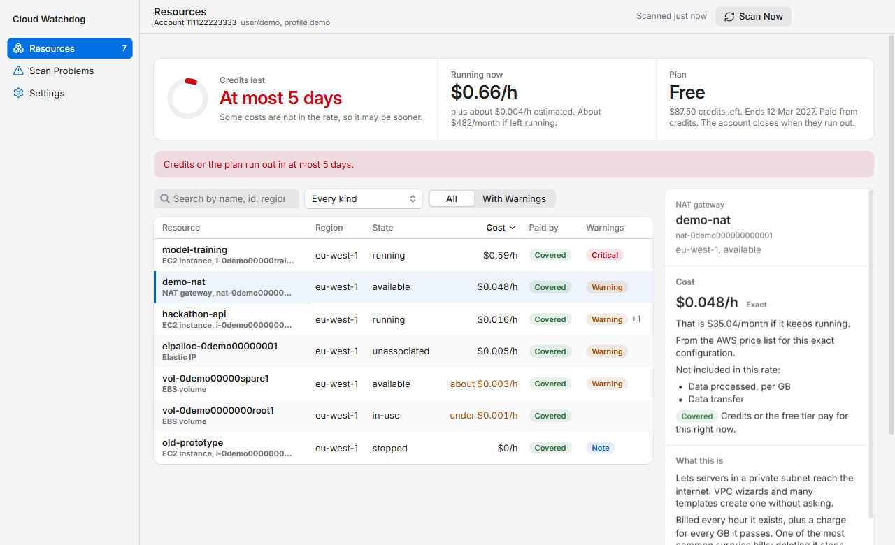
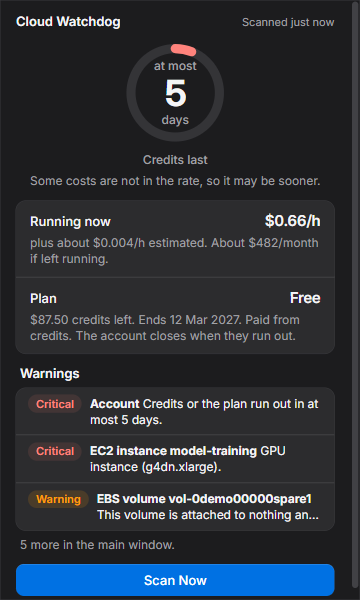

# Cloud Watchdog

A Windows tray app that watches one AWS account for things that are running and
costing money, says what they cost per hour, and tells you how long your credits
will last.

It is for students and hackathon teams on AWS credits or the free plan. Since
15 July 2025 a free-plan account **closes** when its credits run out or after
six months, so a forgotten NAT gateway, GPU instance or idle database can cost
the whole account, not just a bill.



<p align="center">
  
</p>

## What it does

- **Scans every enabled region** on a schedule (every 15 minutes by default, and
  when the computer wakes) for seven kinds of resource: EC2 instances, EBS
  volumes, Elastic IPs, NAT gateways, RDS databases, load balancers and
  SageMaker endpoints.
- **Prices each one per hour** from the public AWS price list, and labels every
  price **exact**, **estimate** or **unknown**. A price it cannot be sure of is
  never shown as exact, and an unknown price never shows a number. Charges that
  depend on usage (data processed, data transfer) are named, not guessed.
- **Reads your plan and credits** from the AWS Free Tier API: free or paid,
  credits left, when the plan ends, and which running resources credits or the
  free tier pay for.
- **Works out the runway**: how many days until the credits or the plan run out
  at the current burn rate.
- **Warns** with a Windows notification when something needs attention:

  | Warning | Default |
  |---|---|
  | Credits or the plan run out soon | within 14 days, critical |
  | The plan has expired | critical |
  | A GPU instance is running | critical |
  | An instance or database has been running a long time | over 24 hours |
  | An instance looks idle | CPU never above 2% for 6 hours (uses CloudWatch, see [Cost](#what-the-app-itself-costs)) |
  | A NAT gateway exists | |
  | A volume is attached to nothing | |
  | An Elastic IP is attached to nothing | |
  | A stopped instance or database still pays for storage | note only |
  | A database this app stopped was started again by AWS after 7 days | |

  Each warning can be switched off or retuned in Settings, and dismissed for a
  while or until it resolves.
- **Shows how to fix it**: for every resource, a link to it in the AWS console
  and the AWS CLI command that removes or stops it, with what to check first.
  The app never runs these commands.
- **Can stop an EC2 instance or an RDS database for you**, if you switch it on
  and give it permission (see [Stopping from the app](#stopping-from-the-app)).
  It never deletes or terminates anything.

## Install

1. Get `Cloud-Watchdog-Setup-1.0.0.exe`: from the repository's Releases page
   when one is published, or build it yourself (see [Build from source](#build-from-source)).
2. Run it. It installs for your Windows user only, in
   `%LOCALAPPDATA%\Programs\Cloud Watchdog`, with no administrator prompt, adds
   a Start Menu entry and starts the app.
3. **Windows SmartScreen will warn** ("Windows protected your PC"), because the
   installer is not code-signed. Choose **More info**, then **Run anyway**.
   Signing costs money every year and is out of scope for this project; build
   from source if you would rather not trust a prebuilt exe.

The app lives in the notification area (the tray). Click its icon for the
summary; right-click for the menu. Closing the main window keeps it running.
It starts when you sign in to Windows, without opening a window; switch that
off in Settings.

**Requirements:** Windows 10 or 11, 64-bit, and an AWS profile on this
computer (below).

**Uninstall** from Settings > Apps > Installed apps. Your settings and scan
history stay in `%APPDATA%\Cloud Watchdog`; delete that folder to remove them.

## Give it access to your AWS account

Cloud Watchdog uses a profile from your AWS CLI configuration
(`%USERPROFILE%\.aws\config` and `credentials`). It reads the profile names to
offer you a choice and signs in through the AWS SDK's normal credential chain.
**It never asks for, stores or copies keys.**

Give that profile **only the read-only policy** in
[`iam/cloud-watchdog-readonly.json`](iam/cloud-watchdog-readonly.json). Do not
use an administrator profile: the app needs to read a handful of things, and
nothing else.

### Option A: an IAM user for the app

With an administrator profile, from this repository's folder:

```
aws iam create-user --user-name cloud-watchdog
aws iam put-user-policy --user-name cloud-watchdog --policy-name CloudWatchdogReadOnly --policy-document file://iam/cloud-watchdog-readonly.json
aws iam create-access-key --user-name cloud-watchdog
aws configure --profile cloud-watchdog
```

Paste the access key and secret from the third command into the fourth. Any
region will do; the app scans all of them.

### Option B: IAM Identity Center (SSO)

Create a permission set with the contents of `cloud-watchdog-readonly.json` as
its inline policy, assign it to your user for the account, then:

```
aws configure sso --profile cloud-watchdog
aws sso login --profile cloud-watchdog
```

SSO sign-ins expire after some hours. Cloud Watchdog does not run the browser
sign-in itself: when the sign-in has expired it says so and shows the
`aws sso login --profile ...` command to copy. After signing in, choose
**Scan Now**. Until then it retries less and less often (at most every 4 hours),
so it does not keep failing in the background.

### Option C: a role

A profile that assumes a role (`role_arn` with `source_profile`) works too. Put
the read-only policy on the role.

### What each part of the policy is for

| Statement | Used for | Without it |
|---|---|---|
| `ScanResources` | listing the seven kinds of resource | nothing works |
| `IdleDetection` | `cloudwatch:GetMetricData`, the idle-CPU warning | no idle warning |
| `PlanAndFreeTier` | plan, credits, expiry and free-tier usage | no runway; a "Plan details unavailable" banner |
| `PublicPriceList` | live prices from `pricing:GetProducts` | prices come from a small snapshot bundled with the app and are shown as estimates, or as unknown when the snapshot does not have them |

The first statement is required. Each of the others can be left out; the app
says what it is missing and keeps working.

### What the app itself costs

All the calls above are free except `cloudwatch:GetMetricData`, which AWS
charges for every time, outside the free tier: one metric per running instance
per hour, about 720 a month for one instance, under one cent. Switch the idle
warning off in Settings to make no such calls.

## Stopping from the app

Off by default. To use it:

1. Add the policy in [`iam/cloud-watchdog-actions.json`](iam/cloud-watchdog-actions.json)
   to the same user, role or permission set. It allows exactly two changes,
   `ec2:StopInstances` and `rds:StopDBInstance`, plus one read-only call used to
   check an instance before stopping it. No start, modify, delete or terminate.
2. In Settings, choose **Switch On Stopping…** and confirm in the dialog, which
   names the account.

Then a running instance has a **Stop This Instance** button, and a database a
**Stop This Database** button. Before anything is sent, the app looks at the
resource in AWS again, lists what stopping it will do
(for example, that its public IP address is given back, or that AWS starts a
stopped database again after 7 days) and refuses when stopping is unsafe or not
allowed: an instance in an Auto Scaling group (which would replace it), one with
instance-store disks (whose contents would be lost), a read replica or a
database with replicas. A Windows dialog,
which the page cannot answer for you, asks you to confirm. Every stop is
recorded in the local database. Choosing another profile switches stopping off.

## What is stored on this computer

Everything is in `%APPDATA%\Cloud Watchdog`:

| File | Holds |
|---|---|
| `settings.json` | the profile name, scan interval, notifications, start at login, whether stopping is on, and your changes to the warnings |
| `watchdog.db` (SQLite) | scan results and history: resource ids, names, settings that affect price, states, prices, warnings, plan snapshots, cached prices and CPU readings, and a log of every stop the app made |

The account id and the ARN of the signed-in identity are stored with the
scans. **No credentials, tokens or keys** are written anywhere. Nothing is sent
anywhere except to AWS: there is no server, no telemetry, no crash reporting
and no auto-update.

## Limitations

- **Windows only.** One AWS account at a time; no AWS Organizations.
- **Seven kinds of resource.** Anything else in the account (S3, Lambda,
  EKS, OpenSearch, and so on) is not seen and not in the burn rate.
- **On-demand list prices in USD.** Spot, Savings Plans, Reserved Instances,
  discounts and tax are not modelled. Usage-based charges (data transfer, NAT
  data processing, load balancer capacity units) are named but not priced, so
  the runway is usually shown as "at most N days".
- **Credits are as fresh as AWS reports them**, which can lag real usage by
  hours. The runway is an estimate.
- **The free-tier matching for accounts opened before 15 July 2025** is built
  from AWS's documentation, not checked against a real account, and leans
  towards "not covered".
- **The installer is unsigned**, so SmartScreen warns, and there are no
  automatic updates: install a new version over the old one.
- Known issues and open review findings are listed in [`docs/REVIEW.md`](docs/REVIEW.md).

## Build from source

Needs Node.js 24 and Windows.

```
npm ci
npm run dev            # run with hot reload
npm run dist           # build release/Cloud-Watchdog-Setup-<version>.exe
```

To try it without an AWS account, use the pretend account (development builds
only). In PowerShell: `$env:WATCHDOG_FAKE_AWS='demo'; npm run dev`.

| Command | What it does |
|---|---|
| `npm run check` | typecheck, lint and unit tests (unit tests cannot reach the network) |
| `npm run test:e2e` | builds the app and drives it with Playwright against the pretend account |
| `npm run test:packaged` | packages the app and smoke-tests the packaged exe |
| `npm run screenshots` | retakes the screenshots in `docs/screenshots` |
| `npm run build-icon` | redraws `build/icon.ico` and `build/icon.png` |

More: [`docs/ARCHITECTURE.md`](docs/ARCHITECTURE.md) for how it fits together,
[`docs/SECURITY.md`](docs/SECURITY.md) for what protects your account and
this computer, and [`PLAN.md`](PLAN.md) for the full plan it was built from.
